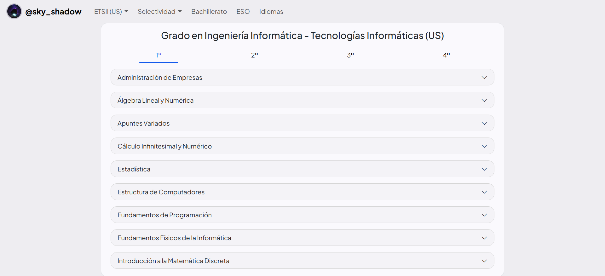
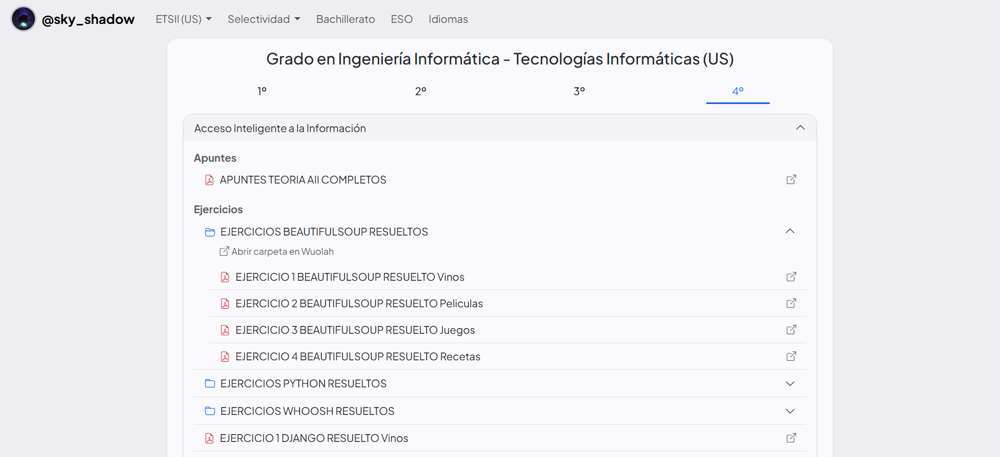

# Wuolah Docs Browser

**Wuolah Docs Browser** es una aplicación web para explorar y organizar apuntes académicos de [Wuolah](https://wuolah.com/) de forma estructurada.

Permite navegar por diferentes comunidades, cursos, asignaturas, carpetas y documentos, proporcionando una interfaz alternativa para consultar el contenido disponible.

🔗 https://sky-shadow-wuolah.vercel.app/

## Preview

## Tecnologías

* HTML5
* CSS3
* JavaScript
* Bootstrap
* Supabase